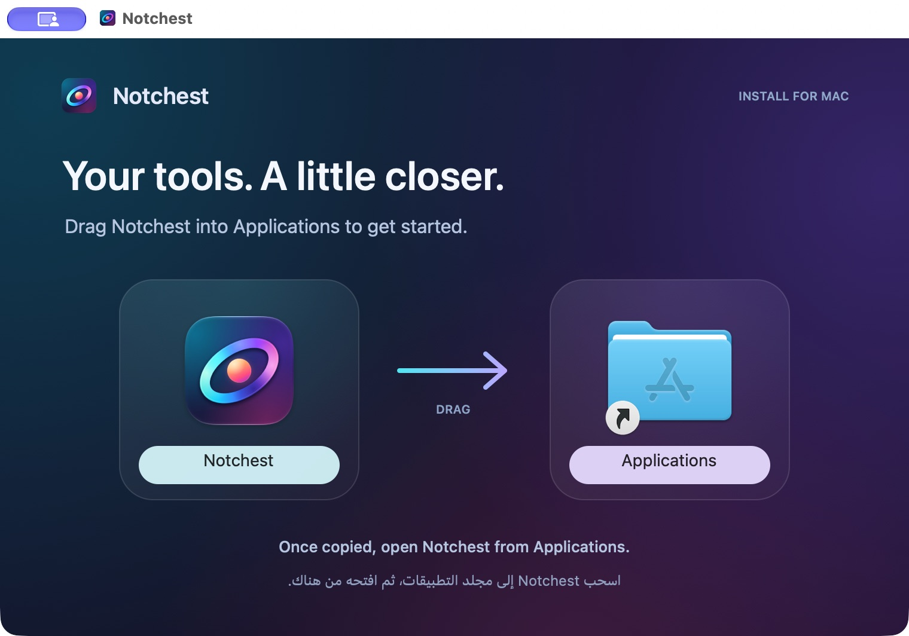

# Notchest installer

A branded, drag-to-Applications disk image that follows the Aurora Orbit identity. The dark aurora background, glass wells and direction arrow are original artwork. The two large icons are real Finder items: the signed app bundle and a symbolic link to `/Applications`.

English is primary; a short Arabic instruction appears beneath it. The 760×500 artwork has a 1520×1000 Retina representation. Light caption wells keep Finder's native filename labels readable. The window opens in icon view with fixed positions and without the toolbar or sidebar.



## Build

```sh
./release.sh
```

The command builds the app and creates `dist/Notchest-0.5.0.dmg` and its portable ZIP. On first use it installs the pinned Python build tools in the ignored `.build/dmg-tools` environment. Python 3.9+ and internet access are needed for that first installation. Users installing Notchest do not need Python or these tools.

The script checks both packages before replacing previous release artifacts. The DMG is mounted read-only to verify its signature, executable permissions, matching binaries and icon, Applications link, background and saved Finder layout. ZIP contents are extracted and their signature checked too. The script does not upload releases or request permission to control Finder.

## Edit the design

- `Scripts/generate-installer-art.swift` draws the background and English/Arabic instructions using AppKit and system fonts. It also embeds the current app icon in the small header.
- `Scripts/dmg-settings.py` controls window dimensions, icon sizes and positions. Keep its coordinates aligned with the two wells in the background generator. Its window height includes space for the native title bar.
- `Scripts/dmg-requirements.txt` pins the packaging tools. These are build-time dependencies only.
- `Scripts/build-dmg.py` packages an existing built app using dmgbuild.
- `Scripts/check-dmg.py` checks the resulting installer and optionally compares it with its source app.

To regenerate artwork without rebuilding the app:

```sh
swift Scripts/generate-installer-art.swift
```

To package and check an existing app after the release tools have been installed:

```sh
.build/dmg-tools/bin/python Scripts/build-dmg.py dist/Notchest.app dist/Notchest-Installer-Preview.dmg
.build/dmg-tools/bin/python Scripts/check-dmg.py dist/Notchest-Installer-Preview.dmg --app dist/Notchest.app
```

`preview.jpg` is a capture of the mounted disk image in Finder, not a composed mockup. Finder supplies the system Applications icon and window chrome, so their appearance can vary with macOS. The background is static artwork; no installation helper runs automatically. Copying and opening the app are initiated by the user.
