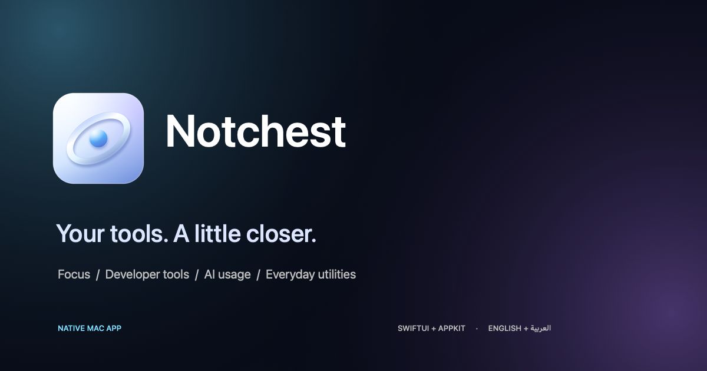
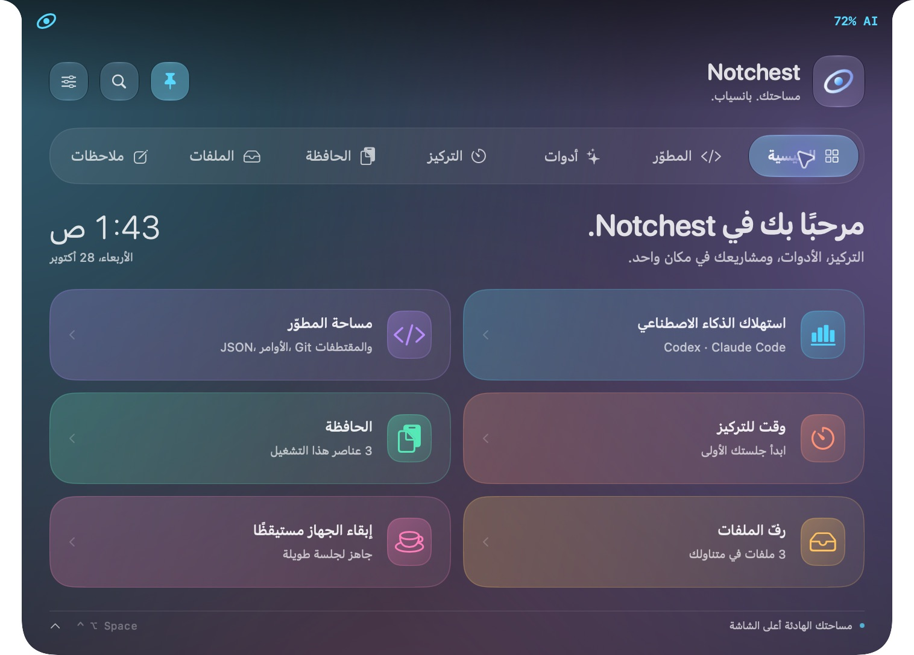
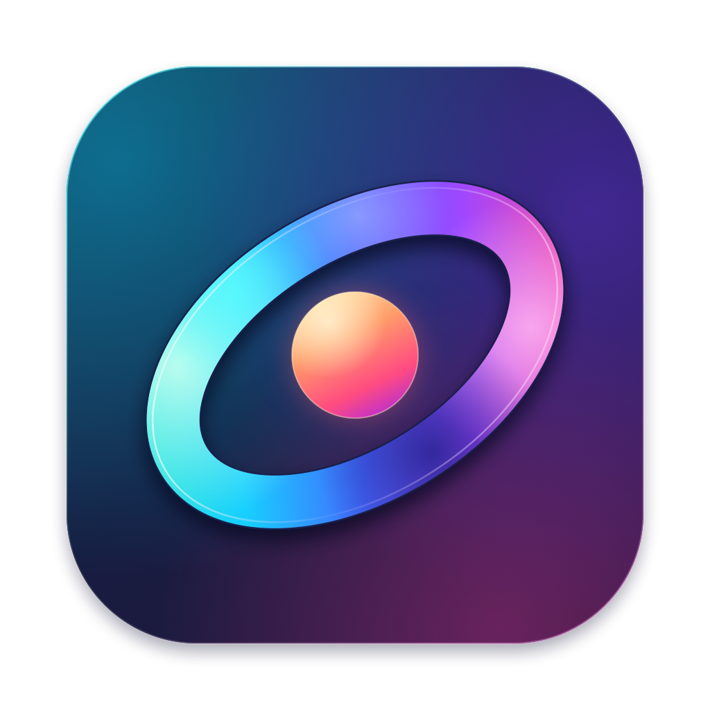

<p align="center"></p>

<p align="center"><a href="https://h0777.github.io/Notchest/ar.html">استكشف التطبيق</a> · <a href="https://github.com/H0777/Notchest/releases/latest">تحميل للماك</a> · <a href="https://h0777.github.io/Notchest/ar.html#features">معرض الميزات الـ39</a> · <a href="README.md">English</a></p>



صور المعرض مأخوذة من التطبيق أثناء تشغيله في نسخة توثيق منفصلة. الملاحظات وأرقام الاستخدام وقراءات النظام والموسيقى وأحداث المهام أمثلة توضيحية، وليست بيانات حسابات شخصية.

---

# Notchest



**Notchest 0.6 — هوية نابضة، وتثبيت مصمّم للماك، ورسائل تتبع لغة الواجهة.**

نسخة أولى موسّعة من تطبيق ماك أصلي بواجهة سوداء تتمدّد أعلى الشاشة، مستلهمة من فكرة Dynamic Island في [Notchy](https://notchy.dev/). الاسم والأيقونة والكود في هذه النسخة أُنشئت لهذا المشروع.

## فتح التطبيق

هذه نسخة المصدر القابلة للتطوير. افتح `Package.swift` في Xcode، أو نفّذ `./build.sh` ثم افتح `dist/Notchest.app`. يمكنك نقل التطبيق الناتج لاحقًا إلى Applications. الواجهة إنجليزية افتراضيًا، والعربية خيار إضافي من Settings → Language. يُحفظ اختيار اللغة عند إعادة التشغيل.

- مرّر المؤشّر فوق الجزيرة، أو انقر عليها، لفتحها.
- **Control + Option + Space** يفتح اللوحة ويطويها.
- **Control + Option + K** يفتح لوحة البحث عن الأدوات.
- **Command + 1…7** ينتقل بين التبويبات عندما تكون اللوحة مفعّلة.
- زر الدبوس يثبّت اللوحة. السهم السفلي أو Escape يطويها. داخل لوحة الأوامر يغلق Escape البحث أولًا.
- من أيقونة Notchest في شريط القوائم يمكنك فتح الإعدادات أو إنهاء التطبيق. يعمل Command + Q أيضًا.

إذا كانت نسخة سابقة من Notchest مفتوحة، أنهِها من أيقونة شريط القوائم ثم افتح النسخة الجديدة لتطبيق التحديث.

## نافذة التثبيت

ينشئ `./release.sh` ملف DMG بنافذة تثبيت خاصة بألوان هوية Notchest، مع سهم وتعليمات لسحب التطبيق إلى Applications. الإنجليزية أساسية والعربية تعليمات إضافية. يتوفر أيضًا ملف ZIP محمول. تُفحص سلامة التطبيق داخل الحزمتين قبل حفظهما. يحتاج بناء DMG إلى Python 3.9 أو أحدث واتصال بالإنترنت في أول تشغيل لتجهيز أدوات البناء محليًا؛ لا يحتاج مستخدم التطبيق إلى هذه الأدوات. [معاينة التصميم وطريقة تعديله](Brand/Installer/README.md).

## حجم الجزيرة والحركة

افتح الإعدادات من أيقونة المنزلقات في رأس اللوحة. يمكنك تغيير **العرض والارتفاع** لكل من الجزيرة المصغّرة واللوحة المفتوحة بصورة مستقلة، وتشاهد حجم اللوحة المفتوحة يتغيّر فورًا. يعرض رقما العرض والارتفاع المقاس الفعلي بنقاط الشاشة؛ يُقيَّد الحجم تلقائيًا ليلائم الشاشة وفتحة الكاميرا. زر **استعادة الحجم** يعيد الأبعاد الأصلية دون تغيير بقية إعداداتك.

يضم قسم الحركة ثلاثة أنماط للسرعة: هادئة ومتوازنة وسريعة، مع خيار لإيقاف الحركة. يشمل التحريك فتح الجزيرة وطيّها والتنقّل بين التبويبات وأقسام الأدوات، ويحترم إعداد «تقليل الحركة» في macOS. تُحفظ التغييرات محليًا عند الإغلاق.

## أدوات المطوّر والذكاء الاصطناعي

| الأداة | ما تفعله |
| --- | --- |
| استهلاك Codex | يقرأ أحداث الاستهلاك من السجلّات المحلية: رموز اليوم وآخر سبعة أيام، رموز الخرج، وإعادة استخدام الكاش |
| حدود Codex | يعرض أحدث لقطة متاحة للنوافذ ونسبة الحد المتبقية وموعد التجديد، مع وقت اللقطة والتنبيه إذا تقادمت |
| استهلاك Claude Code | يقرأ أرقام الاستخدام من سجلّاته المحلية عند وجودها؛ لا يفترض وجود حدود حساب غير مذكورة فيها |
| رسم النشاط | أعمدة لأيام الأسبوع من السجلّات المقروءة، مع تحديث كل 30 ثانية وتخزين نتائج الملفات التي لم تتغيّر لتقليل العمل |
| اختيار المصدر | تبديل المزوّد واختيار مجلّد مخصّص، وإيقاف القراءة المحلية بمفتاح داخل اللوحة |
| JSON | التحقق من الصيغة، التنسيق وترتيب المفاتيح، أو التصغير |
| تحويل النصوص | Base64 ذهابًا وإيابًا، وترميز الروابط وفكّه |
| أدوات إضافية | SHA-256 وUUID ووقت Unix/ISO 8601 وعدّ الكلمات والأحرف والبايتات والأسطر |
| Regex | اختبار التعبير النمطي وإظهار التطابقات وأخطاء الصيغة |
| تشغيل الأوامر | تشغيل أمر zsh غير تفاعلي داخل مجلّد تختاره، وعرض الخرج ورمز الخروج والتنبيه عند الاكتمال؛ زر لإرسال الإيقاف لمجموعة العملية |
| Terminal | طرفية تفاعلية مدمجة تبدأ عند الضغط على زر التشغيل، مع إمكان فتح تطبيق Terminal الخارجي |
| GitHub PR | عرض طلبات سحب المستودع المختار باستخدام GitHub CLI بعد تسجيل الدخول |
| حدود Codex الحية | استعلام اختياري عبر Codex CLI، ويُعرض وقت جلب البيانات |
| النشاط | واجهة محلية اختيارية للسكربتات ومراقبة التنزيلات والأقراص القابلة للإزالة |
| Git | قراءة الفرع وحالة الملفات وملخص الفرق وآخر خمسة التزامات، دون تعديل المستودع |
| المقتطفات | حفظ مقاطع نصية وكود ونسخها بنقرة |

**معنى أرقام الاستهلاك:** الأرقام محلية، وتشمل السجلّات التي تمكّن التطبيق من قراءتها. ليست فاتورة مالية أو رصيد اشتراك، ولا تمثل بالضرورة نشاطًا على أجهزة أخرى أو السحابة. تُحسب المدخلات مرة واحدة، والكاش جزء منها، ولا يُضاف إليها مرة ثانية. تحدّد «آخر سبعة أيام» حسب توقيت الجهاز. لا تُعرض تكلفة تقديرية بلا مصدر موثوق.

اللقطة القديمة لحدود الحساب لا تتحوّل تلقائيًا إلى رصيد جديد. عند توقف الأداة عن كتابة سجلّاتها قد تبقى لقطة الحدود قديمة. صيغة سجلّات الطرف الثالث قابلة للتغيّر، ولذلك هذا التكامل يحتاج صيانة مع تحديثاتها.

المسار الافتراضي لـ Codex هو `CODEX_HOME/sessions` عندما يكون المتغيّر متاحًا للتطبيق، وإلا `~/.codex/sessions`. مسار Claude Code هو `~/.claude/projects`. قارئ السجلات لا يقرأ ملفات كلمات المرور أو مفاتيح API، ولا يحفظ أو يعرض نصوص المحادثات. مفتاح الأسهم الذي تدخله يُحفظ في سلسلة مفاتيح macOS. حدود القراءة: أحدث 1500 ملف، وبحد قراءة يقارب 1 جيجابايت في الدورة؛ عند تجاوز الحدود أو تعذّر القراءة تظهر عبارة «قراءة جزئية».

مرجع معنى حقول حدود Codex: [توثيق OpenAI الرسمي](https://learn.chatgpt.com/docs/app-server).

## أدوات ماك اليومية

| المجموعة | الأدوات الموجودة |
| --- | --- |
| التركيز | مؤقّت 5 أو 25 أو 50 دقيقة، إيقاف واستئناف وإعادة ضبط، صوت عند الاكتمال، عدّاد جلسات، وساعة إيقاف |
| الطاقة | البطارية والشحن، وإبقاء الماك مستيقظًا لمدة ساعة مع إيقاف تلقائي؛ يمكن للشاشة أن تنطفئ وفق إعدادات النظام |
| الملاحظات | نص عربي أو إنجليزي مع حفظ تلقائي على الجهاز |
| الحافظة | سجلّ اختياري لآخر 30 نصًا، بحث ونسخ ومسح؛ معطّل افتراضيًا |
| رفّ الملفات | إضافة حتى 24 ملفًا أو مجلّدًا، سحب إلى الخارج، فتح، إظهار في Finder، وإرسال عبر AirDrop |
| تشغيل التطبيقات | إضافة ملفات التطبيقات من Applications إلى الرف ثم فتحها بنقرة |
| النظام | CPU والذاكرة المستخدمة تقريبًا ومساحة القرص الفارغة؛ قراءات كل أربع ثوانٍ |
| الصوت | مستوى الصوت وتبديل مخرج الصوت وكتم الميكروفون عند دعم الجهاز |
| النوافذ | نصف أيسر، نصف أيمن، أو ملء مساحة العمل، باستخدام صلاحية تسهيلات الاستخدام |
| الصور | تحويل صورة إلى PNG أو JPEG أو HEIC عند دعم الصيغة، واختيار مكان الحفظ |
| لقطة الشاشة | تحديد منطقة عبر أداة macOS وإضافة النتيجة إلى الرف |
| OCR | استخراج نص من صورة منسوخة باستخدام Apple Vision ونسخه للحافظة |
| الألوان | منتقي لون النظام ونسخ قيمة HEX |
| ZIP | ضغط ملف أو مجلّد، وفك ZIP إلى مجلّد جديد |
| الموسيقى | ربط Apple Music أو Spotify، وعرض الغلاف عند توفره، وطلب الكلمات من LRCLIB اختياريًا |
| الطقس | البحث عن مدينة تختارها، وقراءة الطقس من Open-Meteo |
| الأسهم | أسعار آخر إغلاق متاح عبر Alpha Vantage بعد إدخال مفتاحك، وتحديث يدوي |
| الترجمة | ترجمة Apple المدمجة على macOS 15 فما أحدث، وقد تحتاج تنزيل اللغات |
| الكاميرا | نافذة مرآة محلية، مع إيقاف الالتقاط عند إغلاقها |
| التقويم | عرض أحداث الساعات الأربع والعشرين المقبلة من تقاويم Apple الموصولة |
| التذكيرات | إنشاء تذكير في تطبيق Apple Reminders |
| Shortcuts | تحميل اختصارات Apple المحلية وتشغيل الاختصار الذي تختاره |
| البحث والترجمة | فتح النص الذي تدخله في بحث Google أو Google Translate عبر متصفّحك |
| الحاسبة | العمليات الأساسية والأقواس والأولوية والضرب والقسمة وباقي القسمة |

الحافظة لا تُحفظ على القرص، وتُمسح عند الإنهاء أو تعطيل التسجيل. يبدأ الالتقاط من النسخ اللاحق للتفعيل، ويتجاهل النصوص التي تتجاوز 32 كيلوبايت والبيانات التي يوسمها تطبيق المصدر بأنها سرّية أو مؤقتة أو مولّدة تلقائيًا. ليست كل التطبيقات ملزمة بوضع هذه الوسوم.

الرف يحفظ مراجع إلى الملفات الأصلية. إزالة عنصر منه لا تحذف الملف. الملاحظات والإعدادات ومراجع الملفات والمقتطفات وحالة المؤقّت تُحفظ محليًا ضمن إعدادات التطبيق `dev.notchest.island`، وليست خزنة أسرار مشفّرة. ساعة الإيقاف تخص جلسة تشغيل التطبيق الحالية.

## الصلاحيات والاتصالات

الكاميرا والتقويم والتذكيرات والتحكم بتطبيق الموسيقى وتنظيم النوافذ تُستخدم عند اختيار أدواتها. قد يعرض macOS طلب الإذن المناسب. تصوير الشاشة يخضع لصلاحيات macOS. بعض أجهزة الصوت لا تتيح التحكم البرمجي بالصوت أو الكتم؛ الواجهة تبين عدم التوفر.

تحويلات الكود والملاحظات والملفات تُعالج محليًا. قراءة حدود Codex الحية تتصل بحساب Codex عند طلبها؛ الطقس يرسل المدينة إلى Open-Meteo، والكلمات ترسل اسم الأغنية والفنان إلى LRCLIB عند طلبها، والأسهم تتصل بـ Alpha Vantage عند التحديث. البحث والترجمة يفتحان خدمة خارجية عند ضغط زرهما؛ وقد تتصل تطبيقات الموسيقى أو الاختصارات بخدماتها وفق إعداداتها. Notchest لا يضمّن مفاتيح حسابات أو خدمات مدفوعة.

## حالة النسخة

هذه نسخة تطوير فعلية قابلة للتجربة، وليست تنفيذًا كاملًا لكل ميزات Notchy. راجع [FEATURES.md](FEATURES.md) للميزات المتبقية والتحقق التفصيلي.

بُني إصدار التطبيق السابق لـ **Apple Silicon**؛ هذا المجلد يحتوي المصدر. يستهدف المصدر macOS 13 فما أحدث، لكن الاختبار جرى على هذا الجهاز فقط. التوقيع محلي مخصّص للتطوير؛ لم تُجهّز بعد نسخة توزيع عام موقعة بهوية مطوّر ومصدّقة من Apple، أو تحديثات تلقائية.

## البناء والتحقق

لبناء نسخة الهوية الجديدة استخدم Xcode 26 فما أحدث، أو أدوات Swift من Apple مع SDK macOS 26 فما أحدث. يبقى الحد الأدنى لتشغيل التطبيق macOS 13. الطرفية تستخدم مكتبة [SwiftTerm](https://github.com/migueldeicaza/SwiftTerm) المرفقة بالمصدر تحت ترخيص MIT؛ تُرفق نسخة الترخيص داخل التطبيق.

```sh
./build.sh
./check.sh
```

يشغّل `check.sh` مجموعة فحوص فعلية للمؤقّت والحفظ والحافظة والسجلّات والتحويلات والحاسبة وGit وأبعاد الجزيرة وحفظ إعداداتها. توجد أيضًا اختبارات XCTest تُشغّل بـ `swift test` عند توفر Xcode الكامل. يمكن فتح `Package.swift` في Xcode.

`build.sh` يضع التطبيق في `dist/Notchest.app` داخل مجلد المشروع، ويضمّن مساعد الأوامر داخل الحزمة. لإنشاء نسخة لمعمارية أخرى، ابنِ المصدر على الجهاز المستهدف أو اضبط وجهة البناء.

## الهوية البصرية

تضم النسخة 0.4 شعارًا متجهيًا أصليًا وأيقونة للماك بأحجام متعددة، مع تنقل يستخدم Liquid Glass الأصلي على macOS 26 فما أحدث وخامات بديلة على الإصدارات الأقدم. تبقى ألوان التمييز المحفوظة قابلة للاستخدام، وأضيف اللون الجليدي الافتراضي للتثبيت الجديد. يحترم التصميم تقليل الشفافية والحركة وزيادة التباين.

راجع [دليل الهوية](Brand/README.md) لتعديل الأصول وإعادة توليد الأيقونة، و`Sources/Notchest/NotchestDesign.swift` لتعديل خامات الواجهة المشتركة.

## خطة استكمال المشروع

راجع [خطة العمل](ROADMAP.md) لمراحل التنفيذ والأولويات وشروط القبول.
