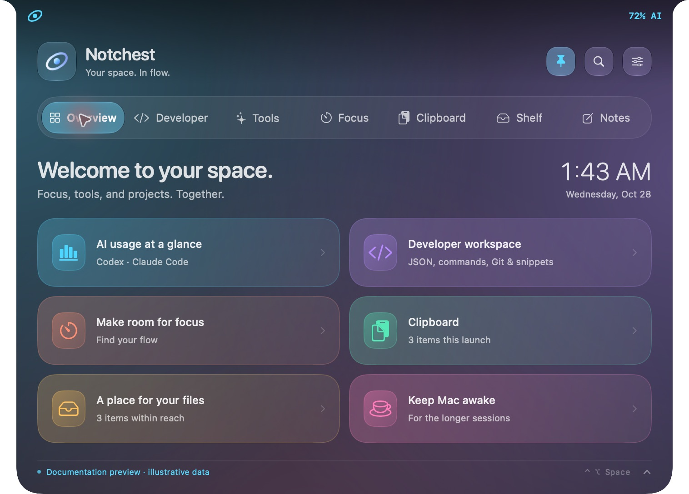
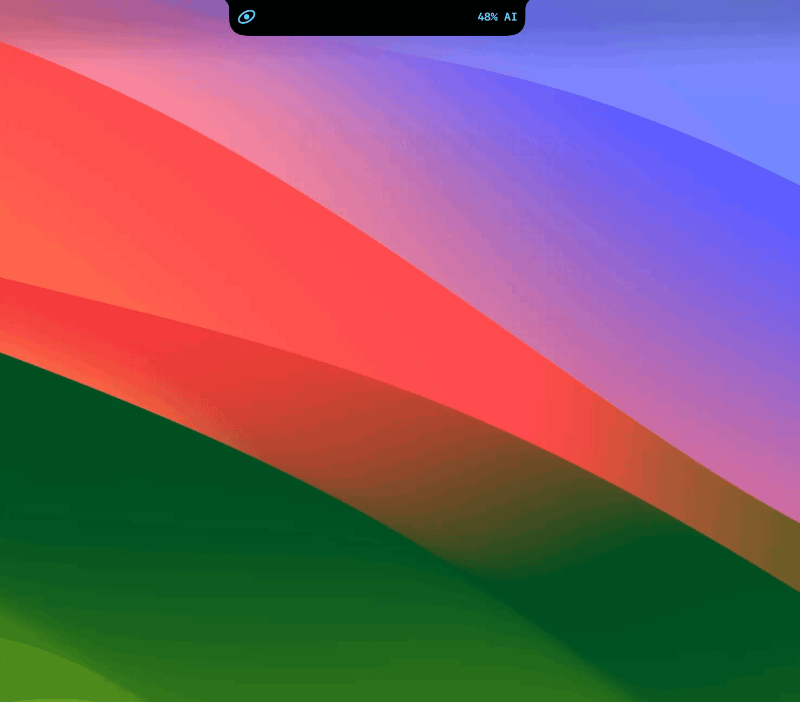
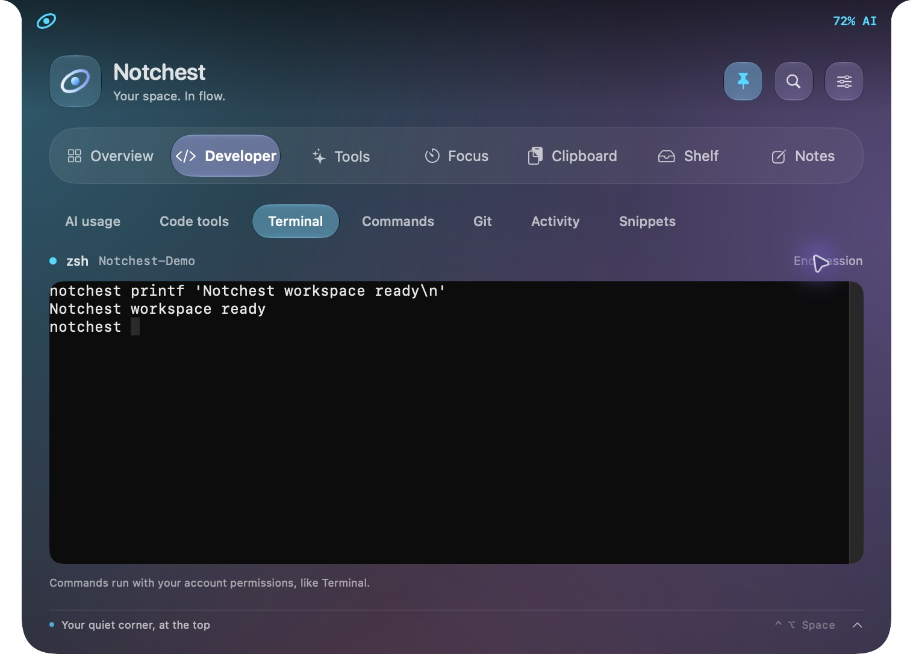
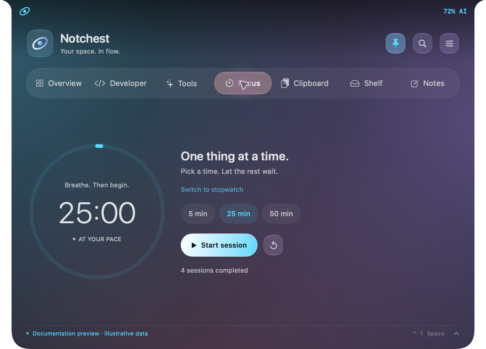
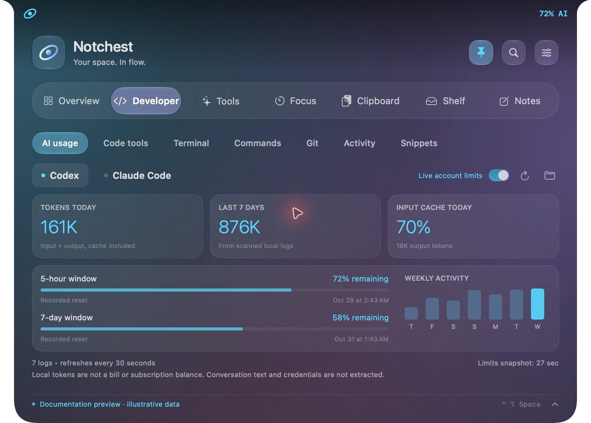
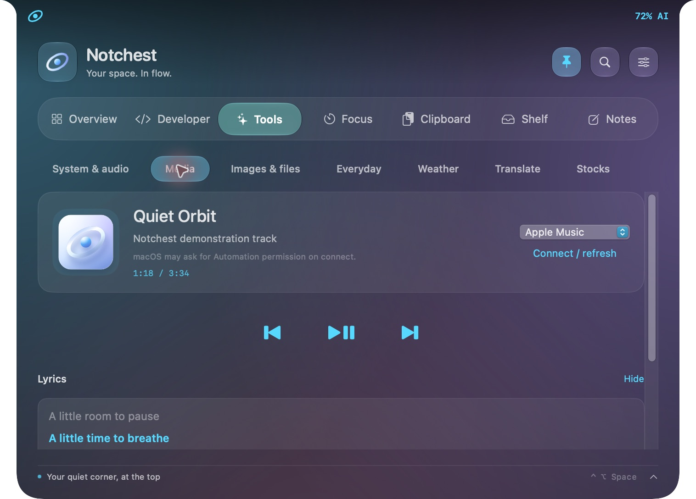

<p align="center">
  
</p>

<p align="center">
  A native Mac island for focus, developer tools, AI usage, and the little things in your day.
</p>

<p align="center">
  <a href="https://github.com/H0777/Notchest/releases/latest"></a>
  <a href="https://github.com/H0777/Notchest/actions/workflows/ci.yml"></a>
  <a href="LICENSE"></a>
  
</p>

<p align="center">
  <a href="https://h0777.github.io/Notchest/">Explore the app</a> ·
  <a href="https://github.com/H0777/Notchest/releases/latest">Download for Mac</a> ·
  <a href="https://h0777.github.io/Notchest/#features">39-feature gallery</a> ·
  <a href="README.ar.md">العربية</a>
</p>

---

## Your notch, with more within reach

Notchest opens a small island at the top of your display. Start a focus session,
open a terminal, catch a thought, or check your tools — then collapse it and
carry on. Aurora colors and native system materials keep it at home on your Mac.

[](https://h0777.github.io/Notchest/#features)

*An actual app capture. Documentation screenshots use labeled sample data;
account usage, system readings, notes, music, and task events are illustrative.*



*The island in motion — a real screen recording of the running app.*

## See what is inside

<table>
  <tr>
    <td width="50%"><a href="https://h0777.github.io/Notchest/#terminal"></a><br><strong>A workspace for your projects</strong><br>Interactive terminal, commands, JSON, Git, pull requests, and snippets.</td>
    <td width="50%"><a href="https://h0777.github.io/Notchest/#focus"></a><br><strong>A little room to focus</strong><br>Focus sessions, stopwatch, notes, clipboard history, and a file shelf.</td>
  </tr>
  <tr>
    <td width="50%"><a href="https://h0777.github.io/Notchest/#ai"></a><br><strong>Your AI activity, in context</strong><br>Local Codex and Claude usage, cache reuse, and on-demand Codex limits.</td>
    <td width="50%"><a href="https://h0777.github.io/Notchest/#music"></a><br><strong>The useful everyday things</strong><br>Music, lyrics, weather, translation, stocks, and Mac utilities.</td>
  </tr>
</table>

**[Explore all 39 features, with screenshots and setup notes →](https://h0777.github.io/Notchest/#features)**

| Space | What you get |
| --- | --- |
| Everyday | Focus timer, stopwatch, autosaved notes, opt-in clipboard, file and app shelf, keep-awake session |
| Developer | SwiftTerm terminal, command runner, JSON, Base64, URL encoding, hashes, UUID, time, regex, Git, GitHub PRs, snippets, local activity API |
| AI usage | Local Codex/Claude statistics and on-demand live Codex limits; source and update time stay visible |
| Mac utilities | Current weather, Apple Translation, stock watchlist, music and lyrics, system readings, supported audio controls, window tiling, image conversion, capture, OCR, ZIP, calculator, Shortcuts, camera mirror, calendar and reminders |
| Yours | Display selection, island dimensions, accent colors, motion, English or right-to-left Arabic, launch at login |

Connected features have setup requirements. The [feature guide](https://h0777.github.io/Notchest/guide.html)
and [status tracker](FEATURES.md) distinguish what is implemented, what needs permission,
and what remains on the roadmap.

## Download

1. Get **Notchest-0.5.0.dmg** from [Releases](https://github.com/H0777/Notchest/releases/latest).
2. Open it and drag **Notchest** into **Applications**.
3. Launch the app and choose the tools you want to connect.

A portable ZIP is available alongside the DMG. This is a development release;
Developer ID signing and Apple notarization remain on the [roadmap](ROADMAP.md).
See the [setup guide](https://h0777.github.io/Notchest/guide.html#start) before installing.

The packaged build is for **Apple Silicon**. Source targets **macOS 13+**;
Apple Translation needs 15+, and Liquid Glass navigation needs 26+.
Older-system and Intel validation are still planned.

## Build from source

Use Xcode 26+, or Apple Swift tools with the macOS 26 SDK.

```sh
git clone https://github.com/H0777/Notchest.git
cd Notchest
./build.sh     # dist/Notchest.app, signed locally for development
./check.sh     # project checks
```

Open `Package.swift` in Xcode to work on the app. `swift test` runs the XCTest
suite when a full Xcode installation is available. `./release.sh` packages a ZIP.

## Documentation

- [Feature gallery](https://h0777.github.io/Notchest/#features) — 25 app captures covering 39 features.
- [Setup guide](https://h0777.github.io/Notchest/guide.html) · [الدليل العربي](https://h0777.github.io/Notchest/guide-ar.html).
- [Roadmap](ROADMAP.md) · [خطة العمل بالعربية](ROADMAP.ar.md) · [Feature status](FEATURES.md).
- [Changelog](CHANGELOG.md) · [Brand assets](Brand/README.md) · [Screenshot provenance](Brand/GALLERY.md).

## Contribute

Ideas, focused fixes, and reproducible bug reports are welcome. Include your
macOS version, display setup, and steps to reproduce. Please check the
[roadmap](ROADMAP.md) before starting a larger integration.

## Privacy and license

Local tools work without an account. Optional services connect when requested
or configured. Clipboard history is in memory and cleared on quit; stock API
keys are stored in Keychain. Camera, automation, calendar, and accessibility
features follow macOS permissions.

MIT — [LICENSE](LICENSE). SwiftTerm retains its [upstream MIT license](THIRD_PARTY_NOTICES.md).
